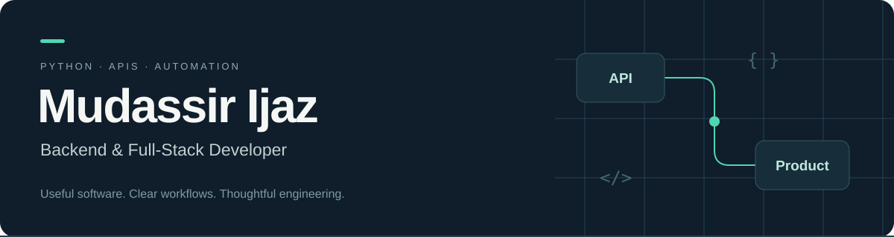

**Python backend developer in Pakistan. I build FastAPI services, PostgreSQL workflows, and React interfaces for the people who use them.**

[Portfolio](https://mudassirejaz.vercel.app/) &nbsp; · &nbsp; [LinkedIn](https://linkedin.com/in/mudassir-ijaz) &nbsp; · &nbsp; [Email](mailto:snakelogic354@gmail.com)

## Featured projects

### BatchTrace · Inventory expiry and supplier returns

BatchTrace helps inventory teams track batches nearing expiry, review supplier returns, and reconcile expected credit. I built a CSV import flow that preserves historical stock evidence, plus approval steps that keep the submitter and reviewer separate.

**FastAPI · PostgreSQL · SQLAlchemy · React · TypeScript**

[Source code](https://github.com/mudassirejaz-art/batchtrace) · [Public showcase](https://mudassirejaz-art.github.io/batchtrace/) · [Local setup](https://github.com/mudassirejaz-art/batchtrace/blob/main/docs/USER_GUIDE.md)

### ParentReport · School reporting and parent portal

ParentReport gives teachers a class workspace for publishing marks and guardians a mobile portal for reading their linked children’s results. I implemented class and guardian access rules in PostgreSQL, plus a WhatsApp queue that rechecks consent before sending. The local demo uses fictional data and simulated delivery.

**FastAPI · PostgreSQL · React · TypeScript · Remotion**

[Source code](https://github.com/mudassirejaz-art/parent-report-whatsapp) · [Public showcase](https://mudassirejaz-art.github.io/parent-report-whatsapp/) · [Local setup](https://github.com/mudassirejaz-art/parent-report-whatsapp#run-locally)

## Other work

| Project | What it demonstrates |
| --- | --- |
| [FastAPI Auth API](https://github.com/mudassirejaz-art/fastapi-auth-api) | Access and refresh tokens, hashed secrets, and protected endpoints |
| [Excel Report CLI](https://github.com/mudassirejaz-art/excel_report_cli) | Excel reporting from SQLite with a Python command-line tool |
| [REST API Series](https://github.com/mudassirejaz-art/restapi-series) | A Flask scraping API that returns structured JSON |

## Toolkit

- **Backend and data** · Python, FastAPI, Django, Flask, PostgreSQL, SQLAlchemy, SQLite
- **Frontend** · React, TypeScript, JavaScript, Tailwind CSS
- **Development** · Git, Docker, Linux, command-line tooling

I’m interested in Python backend roles and projects involving APIs, database workflows, and reporting automation.

[See more repositories](https://github.com/mudassirejaz-art?tab=repositories) · [Get in touch](mailto:snakelogic354@gmail.com)
