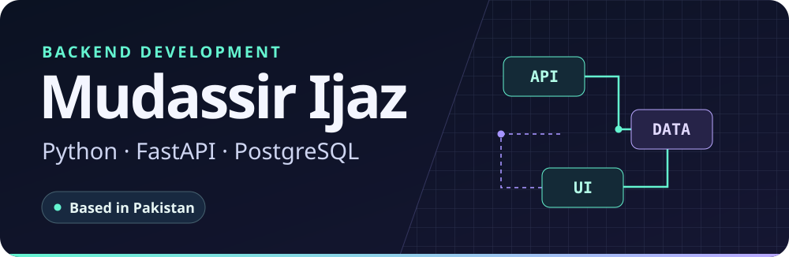

[Portfolio](https://mudassirejaz.vercel.app/) &nbsp; · &nbsp; [LinkedIn](https://linkedin.com/in/mudassir-ijaz) &nbsp; · &nbsp; [Email](mailto:snakelogic354@gmail.com)

I build Python APIs and the workflows behind them, from how a record enters the system to who can review it and what happens next.

## Selected projects

<table>
<tr>
<td width="39%"></td>
<td>
01 / INVENTORY OPERATIONS
<h3>BatchTrace</h3>
Track expiring stock, review supplier returns, and reconcile expected credit. CSV imports preserve historical evidence, and independent reviewers approve stock checks and credit records.
  
<a href="https://github.com/mudassirejaz-art/batchtrace"><strong>Source</strong></a> · <a href="https://mudassirejaz-art.github.io/batchtrace/">Showcase</a> · <a href="https://github.com/mudassirejaz-art/batchtrace/blob/main/docs/USER_GUIDE.md">Local setup</a>
</td>
</tr>
<tr>
<td width="39%"></td>
<td>
02 / SCHOOL REPORTING
<h3>ParentReport</h3>
Teachers publish class results and guardians see only their linked children’s reports. PostgreSQL scopes access, and a WhatsApp queue rechecks consent before dispatch. The local demo simulates delivery.
  
<a href="https://github.com/mudassirejaz-art/parent-report-whatsapp"><strong>Source</strong></a> · <a href="https://mudassirejaz-art.github.io/parent-report-whatsapp/">Showcase</a> · <a href="https://github.com/mudassirejaz-art/parent-report-whatsapp#run-locally">Local setup</a>
</td>
</tr>
</table>

## Toolkit

| Backend | Data | Interface and tools |
| --- | --- | --- |
| Python · FastAPI · Flask | PostgreSQL · SQLAlchemy · SQLite | React · TypeScript · Git · Docker · Linux |

## Smaller builds

| Repository | What I built |
| --- | --- |
| [FastAPI Auth API](https://github.com/mudassirejaz-art/fastapi-auth-api) | Token authentication and protected endpoints |
| [Excel Report CLI](https://github.com/mudassirejaz-art/excel_report_cli) | A CLI that turns SQLite data into Excel reports |
| [REST API Series](https://github.com/mudassirejaz-art/restapi-series) | A Flask API that extracts structured web data |

[Browse all repositories](https://github.com/mudassirejaz-art?tab=repositories)
